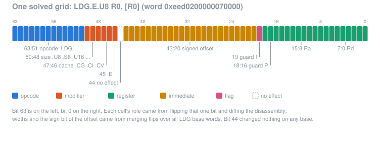
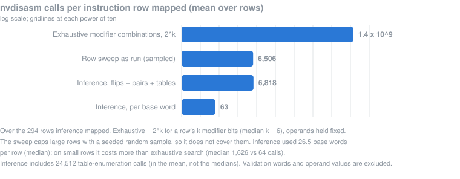

# How the decoder's encodings were learned

Shadowbox decodes Maxwell (SM52) GPU instructions. Each instruction is a
64-bit word, and the decoder has to know which bits mean what: which bits
say "this is a load", which bits name the destination register, which bits
hold an offset. NVIDIA does not publish that layout. This document explains
how we learned it, so that readers can check that the decoder was built
clean room.

We used three methods in turn. Each one was built to cover what the one
before it could not prove:

1. **Field sampling**: try each field from a public encoding table, one at
   a time.
2. **Oracle sweeps**: generate many words and compare Shadowbox's answer
   with the answer from NVIDIA's own disassembler.
3. **Bit-flip inference**: work out each instruction family's whole field
   layout from single-bit changes, then check it on words nobody has seen.

The last method is easiest to understand as a sudoku, so that comes first.
The source rules behind all of this are in [CLEAN-ROOM.md](../CLEAN-ROOM.md),
and the [provenance](#provenance) section at the end summarises them for
the decoder.

Methods 2 and 3 can be rerun by anyone: the tools are in
[tools/discovery](../tools/discovery/README.md), and
`tools/discovery/run.sh` runs both end to end from the decoder tables in
`crates/shadowbox/tests/data/` and words the tools make up.

## Terms

- **Word**: one 64-bit Maxwell instruction. Bits are numbered 63 (left) to
  0 (right).
- **Row** or **family**: one line of the envytools gm107 opcode table (an
  `OP8B` entry). It gives a mask and value over the opcode bits that pick out
  one instruction family, for example `0x5ca8` for F2F. Shadowbox's list of
  rows is [decoder-rows.tsv](../crates/shadowbox/tests/data/decoder-rows.tsv).
- **Field**: a group of bits with one job, such as "destination register"
  or "cache mode".
- **The oracle**: `nvdisasm` from NVIDIA's CUDA 11.8 redistributable, run
  locally as a black box with `-b SM52 -raw`. We give it a word and read the
  text it prints (for example `LDG.E.U8 R0, [R0]`), or note that it refused
  the word. Nothing else from it is used.

## The sudoku paradigm

Think of each instruction family as a sudoku grid with 64 cells, one per
bit. Solving the grid means writing a role into every cell: opcode,
modifier, register, immediate, flag, operand form, or "no effect".

- **Givens.** Words the oracle accepts are the given numbers. We know they
  are valid, and we can read their meaning from the printed text.
- **Probes.** Flip one bit of a given and ask the oracle again. The
  difference between the two printed texts pins that one cell's role. If
  `R0` became `R4`, the bit is part of a register field, and since 4 is 2^2
  it is the third bit of that field. If `.U8` became `.S8`, it is a modifier
  bit. If the instruction name changed or the word was refused, it is an
  opcode bit.
- **Constraints carry across cells and words.** A field is a contiguous run
  of bits unless evidence says otherwise. A register field's values map
  onto `R0` to `RZ` (8 bits, with 255 meaning RZ), and a predicate field's
  onto `P0` to `PT` (3 bits, with 7 meaning PT). A modifier's values come
  from a closed table: every value prints one fixed set of suffixes. So once
  bit 0 shows `R0` to `R1` and bit 7 shows `R0` to `R128`, the six bits
  between them are deduced as the same register field, not enumerated.
- **Elimination.** A cell that never changes the text, on any given, is
  "no effect". A cell that only ever makes the oracle refuse the word is an
  opcode bit.
- **Contradictions.** A cell with two candidate roles, a register bit on one
  given and a modifier bit on another, is a conflict. As in a sudoku, a
  contradiction means more information is needed: more probes (flipping two
  neighbouring bits together) or splitting the grid, because the family has
  more than one operand form and each form needs its own grid.
- **Checking the solution.** A solved grid predicts the text of any word
  built from it. Composing words nobody has seen and asking the oracle
  whether it prints exactly the predicted text is checking the solved
  puzzle.

Most of the grid is deduced from a few dozen probes per given, instead of
being enumerated value by value. That is why the third method is so much
cheaper than the first two for large families, as the
[discovery rate](#discovery-rate) section shows.

## Method 1: field sampling

### The idea

The envytools gm107 table (MIT) already lists, for each row, the fields that
make up the word. If every value of every field is tried once against a
fixed baseline word, each field is proven to decode as the table says.

### The algorithm

This is what [decoder-coverage.md](decoder-coverage.md) documents and
`cargo test --test decoder_coverage` regenerates.

1. Read each row of the envytools table: its opcode mask and value, and the
   fields its operands use.
2. Build a baseline word for the row: the opcode bits set, every operand
   field zero.
3. For each field, make one sample per value while every other field stays
   at the baseline: every selector value (assigned or not), every flag value,
   every predicate, small immediates in full, and zero, one, the maximum, the
   sign boundary and each single bit for larger operands.
4. Decode every sample with Shadowbox and check in the answer, so any decoder
   change that alters an answer shows up in review.

### What it proves and what it cannot

It proves each field on its own: the decoder reads that field from the bits
the table names, and accepts or rejects each value as expected. It never
proves combinations. Two modifiers that are fine alone may form a word the
hardware rejects, or a family member the table never describes. Games kept
hitting such members, for example an F2F with a 16-bit high-half source (row
`0x5ca8` with bit 41 set), or IPA reading the FrontFacing attribute at
`0x3fc`. Sampling can also hide whole rows: the all-zero baseline gives
operands some decoders do not admit (IPA needs RZ sources, a PT predicate and
an attribute address of `0x80` or above).

## Method 2: oracle sweeps

### The idea

Generate many words, give each to the oracle and to Shadowbox's decoder, and
compare. Each word lands in one of four outcomes:

- **agree**: both decode with compatible names, or both reject;
- **undiscovered member**: the oracle prints an instruction and Shadowbox
  says Unknown;
- **wrong admission**: Shadowbox decodes a word the oracle rejects (text
  containing `INVALID<n>` counts as a rejection);
- **name mismatch**: both decode, but Shadowbox's instruction kind cannot
  stand for the name the oracle printed.

The two sweeps differ in where the words come from.

### Row sweep

The row sweep tests combinations inside the families we already know.

1. From the field samples, derive each row's bit masks and split the
   non-opcode bits into modifier bits (selectors, flags, small control
   immediates), data bits (registers, predicates, constant-buffer and
   immediate operands, offsets, branch targets) and uncovered bits that no
   sampled field touches.
2. Pick a neutral operand anchor per row that Shadowbox can decode: for each
   register field the baseline or RZ, for each predicate field the baseline
   or PT, for each attribute address the baseline or `0x80`. Keep the
   combination under which the most modifier samples decode, so a row is not
   reported missing only because of its operands.
3. Keep the opcode bits fixed and the operands at the anchor (and at the
   original baseline when the anchor differs). Vary the modifier bits
   together: every combination when a row has few modifier bits, a seeded
   random sample otherwise.
4. Add words with uncovered bits set, alone, in pairs, and paired with each
   modifier bit. Give attribute rows every attribute address and
   system-register rows every system register.
5. Attribute each word to the first row that matches it in table order, the
   row a table-order decoder would pick.
6. Disassemble every word with the oracle and decode it with Shadowbox.
7. Sort the differences into the outcomes above. Cluster undiscovered
   members by name, modifiers and operand shape, and label each cluster with
   the nearest word Shadowbox does decode and the bits that differ. A million
   lines of output become a ranked list of concrete missing forms.

### Opcode-space sweep

The row sweep can only find members of families we know, because the opcode
bits never move. The opcode-space sweep walks the opcode space itself.

1. Take all 65,536 values of the top 16 bits, the granularity of row keys
   such as `0x5ca8`.
2. Give each prefix four neutral anchors for the low 48 bits: all zeros; RZ
   in the usual register fields with PT in the guard and predicate fields;
   and two seeded random fills with the guard kept at PT so the word is live.
3. Tag each word with the first known row that matches it, or none.
4. Disassemble and decode every word.
5. Report prefixes the oracle decodes but no row covers (new families),
   words inside a covered prefix that match no row (opcode bits below bit
   48), Unknown words that do match a row, wrong admissions, and prefixes
   whose four anchors disagree on the instruction name (an opcode bit lives
   in the low 48 bits there).

### Running the oracle

The oracle reads a raw file of 32-byte groups: a scheduling control word,
the word under test, and two NOPs. It stops at the first word it cannot
decode and names its address. The runner marks that word rejected and
carries on with the rest of the batch, so a batch costs one process plus one
per rejected word. Batches run on the local machine by default; with an
optional hosts file they are split across machines and balanced by the
reject rate of a small pilot run. The row sweep and the opcode-space sweep
are `family-sweep.sh` and `family-sweep.sh --space opcode` in
[tools/discovery](../tools/discovery/README.md).

The oracle's answer for a word is a pure function of the binary, the
invocation, the word's address and the word, so every answer is kept once in
a shared answer store keyed by those, and a run asks only for words the
store lacks. Each ask checks a random 1% of the stored answers it uses (at
least 200) against the live oracle; any mismatch stops the run, because it
would mean the key misses something that changes the text.

### What it proves and what it cannot

A sweep proves exactly the words it generated. A clean sweep is strong
evidence against wrong admissions, because every word Shadowbox accepts was
put in front of the oracle. It proves nothing about words it did not
generate, and combinations grow faster than any sweep. Operands stay at a
few anchors, so operand-dependent behaviour is only sampled. Like every
method here, it checks names and fields, not what an instruction does.

### Illustration (runs of 2026-10-20)

These are one day's numbers, given to show scale, not a guarantee about the
current decoder.

- Opcode-space sweep: 262,144 words. The oracle decoded words in 48,122
  prefixes. Seven families had no row: TEX, TLD4, TLD, TXD, SUATOM, CCTLT
  and NOP. They became the next rows to add.
- Row sweep over every row: about 1.9 million words, with 0 wrong
  admissions and 0 name mismatches once the decoder read fields instead of
  matching whole words. Every remaining difference was an undiscovered
  member, the safe direction: Shadowbox refuses rather than guesses.

## Method 3: bit-flip inference

### The idea

Sampling never ends, because combinations outgrow it. Inference solves the
sudoku instead: the result is the field layout itself, so words never seen
decode by construction. The check is constructive too: build new words from
the layout, predict their text, and ask the oracle whether it prints exactly
that.

### The algorithm

1. **Collect the givens.** For each row, gather words the oracle accepts:
   the field samples it accepts, plus the accepted words of an opcode-space
   sweep, assigned to the row they match. Keep one given per name, modifier
   set and operand shape; a second word of the same shape only repeats the
   same probes.
2. **Probe every cell.** Flip each of the 64 bits of every given and
   disassemble the results.
3. **Read each probe.** Split each printed text into guard, name, dotted
   modifiers and operands, and compare the flipped text with the given's
   text. In order of precedence, the flipped bit is:
   - **opcode**: the name changes, or the oracle refuses the word;
   - **form**: the number of operands, or of values inside one, changes;
   - **modifier**: the dotted suffixes change (which names appear or vanish
     is kept);
   - **enum**: a named operand value changes, such as `1D` to `2D`;
   - **flag**: only a `-`, `|..|`, `!` or `~` on an operand changes;
   - **register**: one register or predicate number changes by 2^k, which
     places the field's first bit at k below this one;
   - **immediate**: one number changes (a value bit, a sign, or a float bit);
   - **no effect**: the text is identical.
4. **Probe neighbours together.** For neighbouring bits that both act as
   modifier, enum or flag bits on a given, flip both at once. If the result
   is not the two single flips combined, the two bits are one field.
5. **Fill the grid.** Per row, give each bit its most common informative
   role (a bit that only ever causes refusal is an opcode bit), join runs of
   bits with one role and key into fields, and build each modifier's value
   table from every accepted word of the row.
6. **Record contradictions.** Keep every disagreement as a finding: a bit
   with two roles on different givens, a bit with a role on some givens and
   no effect on others, register or immediate fields whose position differs
   between givens, and a modifier value that prints two different suffix
   sets.
7. **Check the solved puzzle.** For each row, compose new words from the
   layout: set the register, immediate, modifier, flag and no-effect fields
   at random on a given (modifiers only to values in their table), skipping
   any word already known. Predict the text from the layout and compare it
   with what the oracle prints. A word is **exact** when the strings are
   identical, and **canonical** when the name, modifier set and operands
   agree after normalising how they are printed.

`family-infer.sh` in [tools/discovery](../tools/discovery/README.md) runs
these steps; `family-sweep/infer.py` holds the text model and the rules.
Layout works row by row, so the layout passes run as a work queue of row
groups spread over every available machine and merge into the same tables
one process would write.

Composed validation words follow the current layout, so they change
whenever the layout does. A **frozen evaluation set**, drawn once per row
with a recorded seed, is scored on every run as well, so exact-match rates
compare across runs; the composed set stays as the check that a layout is
not fitted to the frozen words.

### Worked example: LDG

LDG loads from global memory. Take the given word `0xeed0200000070000`,
which the oracle prints as `LDG.E.U8 R0, [R0]`: load an unsigned byte into
`R0` from the address in `R0`, with the `.E` (64-bit address) modifier. Flip
each bit in turn:

| Bit flipped | Oracle prints | What the cell is |
| --- | --- | --- |
| 0 | `LDG.E.U8 R1, [R0]` | first operand register, value bit 0 |
| 3 | `LDG.E.U8 R8, [R0]` | first operand register, value bit 3 |
| 7 | `LDG.E.U8 R128, [R0]` | first operand register, value bit 7 |
| 8 | `LDG.E.U8 R0, [R1]` | address register, value bit 0 |
| 15 | `LDG.E.U8 R0, [R128]` | address register, value bit 7 |
| 16 | `@P6 LDG.E.U8 R0, [R0]` | guard predicate (7 = PT becomes 6) |
| 18 | `@P3 LDG.E.U8 R0, [R0]` | guard predicate, value bit 2 |
| 19 | `@!PT LDG.E.U8 R0, [R0]` | guard negation flag |
| 20 | `LDG.E.U8 R0, [R0+0x1]` | offset, value bit 0 |
| 42 | `LDG.E.U8 R0, [R0+0x400000]` | offset, value bit 22 |
| 43 | `LDG.E.U8 R0, [R0+-0x800000]` | offset sign bit |
| 44 | `LDG.E.U8 R0, [R0]` | no effect |
| 45 | `LDG.U8 R0, [R0]` | modifier: `.E` |
| 46 | `LDG.E.CG.U8 R0, [R0]` | modifier: cache mode |
| 47 | `LDG.E.CI.U8 R0, [R0]` | modifier: cache mode |
| 48 | `LDG.E.S8 R0, [R0]` | modifier: size |
| 50 | `LDG.E R0, [R0]` | modifier: size |
| 51 | `STG.E.U8 [R0], R0` | opcode (became a store) |
| 52 | refused | opcode |
| 56 | `ISBERD R0, [R0]` | opcode |

The other bits of each run behave the same way. Merged with the probes of
LDG's other givens and the pair flips, this gives the solved grid:

| Bits | Field | Values |
| --- | --- | --- |
| 63:51 | opcode | LDG; other values are other instructions or invalid |
| 50:48 | size modifier | 0 `.U8`, 1 `.S8`, 2 `.U16`, 3 `.S16`, 4 none (32-bit), 5 `.64`, 6 `.128`, 7 `.U.128` |
| 47:46 | cache modifier | 0 none, 1 `.CG`, 2 `.CI`, 3 `.CV` |
| 45 | `.E` modifier | 0 none, 1 `.E` |
| 44 | no effect | |
| 43:20 | address offset | 24-bit signed immediate |
| 19 | guard negation | `!` on the guard predicate |
| 18:16 | guard predicate | `P0` to `P6`, 7 = `PT` |
| 15:8 | address register | `R0` to `R254`, 255 = `RZ` |
| 7:0 | destination register | `R0` to `R254`, 255 = `RZ` |

Single flips of this given only reach size values 1, 2 and 4. Values 3, 5,
6 and 7 come from the closed-table constraint: every accepted LDG word
contributes the value it carries. In the 2026-10-20 run this row had no
conflicts, and all 16 composed words were predicted exactly.

### Refinements

The first pass solves most grids. Four refinements handle the patterns that
a flat grid of contiguous fields cannot express.

**Joint fields.** Some modifiers are spread over bits that are not
neighbours, or one bit's meaning depends on another field.

1. Join neighbouring modifier, enum or flag bits when their pair flip is
   not the two single flips combined (step 4 above).
2. Merge any two modifier fields that print an overlapping suffix, even when
   they are far apart.
3. If a field's values still map to more than one suffix set, try joining
   it with each other selector field in turn, and keep the join that removes
   the most ambiguity. Repeat until no join helps. The result may be split,
   such as bits 12 and 9:8 read as one value.

**Signed immediates.** An offset or constant may be split over several runs
of bits, and its top bit may be a sign.

1. Collect every immediate run that changes the same operand, lowest run
   first, as one value.
2. Check that each bit k moves the value by 2^(k + s) for one fixed shift s;
   s gives the scale (a byte offset counted in words, for example).
3. If the top bit makes the printed value negative, or moves it by more than
   one power of two, read the whole value as two's complement over its full
   width. LDG's bit 43 is this case.

**Exhaustive modifier tables.** A table built only from accepted words
contains only values someone happened to use.

1. For every modifier or enum field of at most 12 bits whose table is not
   yet complete, take one given and build a word for every value of that
   field.
2. Ask the oracle about each of those words, once.
3. Fold the answers into the table, so it is closed rather than sampled.
   Wider fields are recorded as unenumerated findings.

**Per-form layouts.** Some families have more than one operand form: one
bit chooses between, say, a register source and an immediate source, and
the same bits then mean different things.

1. Mark as form bits every bit whose flip changes the operand list on any
   given.
2. Group the row's givens by the values of their form bits.
3. Solve each group as its own grid, with its own fields and tables. A
   register field that moves between forms is then two answers in two grids,
   not one conflict.

### Measured effect of the refinements

The four refinements were run together as a second pass over the same
givens and flips, so they are measured together. Each one is traced here
through the conflict kind or field it targets.

| | First pass | Refined pass |
| --- | --- | --- |
| Composed words predicted exactly | 80.3% (3,709 of 4,619) | 86.0% (3,945 of 4,585) |
| Predicted canonically | 82.8% | 90.2% |
| Composed words the oracle refused | 76 | 28 |
| Rows below 50% exact | 55 of 290 | 33 of 288 |
| Rows at 90% exact or better | 194 | 209 |
| Slot-shift conflicts | 802 | 48 |
| Multi-role conflicts | 1,121 | 686 |
| Value-ambiguous findings | 503 | 11,216 |

- **Per-form layouts** split 180 rows into more than one grid, 1,501 grids
  in all. This is what took slot-shift conflicts from 802 to 48: a field
  that moved between forms is now two fields in two grids.
- **Joint fields** produced 251 fields made of split bit runs, and 21
  modifier fields joined with another selector.
- **Signed immediates** read 408 of 1,629 immediate fields (counted per
  form) as one two's-complement value, LDG's offset among them.
- **Exhaustive modifier tables** built 58,052 enumeration words, of which
  24,512 had not been asked before, covering every modifier and enum field
  of 12 bits or less. Six wider fields remain unenumerated.

The rise in value-ambiguous findings comes from the closed tables, not from
a regression. A sampled table only listed values seen in real words; a
closed one lists every value, including those whose printed suffixes
depend on another field. Those are the cases the next step has to resolve.

### What is still left

The refined layouts still miss in five known ways:

- **Modifier print order.** The oracle prints suffixes in a fixed order. The
  model learns that order from accepted words, so a composed word that
  combines suffixes never seen together can have the right suffixes in the
  wrong order.
- **Flag and modifier joint fields.** Some bits act as an operand flag in
  one setting and as a modifier in another. These are not joined yet.
- **Predicate-register forms.** Some families switch an operand between a
  general register and a predicate register. These forms are not yet
  separated into their own grids.
- **PC-relative immediates.** Branch targets print as an address relative
  to the instruction's own position, not as the raw field value. The layout
  does not model that yet.
- **Invalid value combinations.** Two field values can each be valid alone
  and refused together. A flat layout has no way to say so, which is one
  reason some composed words are still refused.

### What it proves and what it cannot

A layout that predicts the oracle's exact text for words it has never seen
is evidence that the fields, their widths and their tables are right, not
just the sampled points. The conflicts list shows where a layout is not yet
enough, usually because one field's meaning depends on another. Inference
cannot see interactions no given exercises, and before the exhaustive-table
refinement its tables only hold values seen in accepted words. Like the
sweeps, it learns encodings, not behaviour.

### Illustration (2026-10-20)

- About 31,600 givens, 1.8 million single flips and 179,000 pair flips.
- Layouts for 294 of 296 rows.
- First pass: of 4,619 composed words never seen before, 80.3% were
  predicted exactly and 82.8% canonically; 55 rows were below 50% exact.
- Refined pass: of 4,585 composed words, 86.0% exact and 90.2% canonical;
  33 rows below 50% exact.

## Discovery rate

How much faster did each stage make discovery? The charts put the stages
on one log scale. The numbers come from the 2026-10-20 runs (both inference
passes) and are produced from those runs by
[tools/discovery-rate-charts.py](../tools/discovery-rate-charts.py); the
counts it read are in [img/discovery-rate.tsv](img/discovery-rate.tsv).

1. **Field sampling, with gaps otherwise found when a game failed.** One
   game harvest, 45 minutes of play, surfaced 3 distinct decoder failures:
   about 4 per hour. Investigating each failure took far longer and is not
   counted. The field-sampling generator itself cannot be timed from the
   project history (its tables grew across many commits that also changed
   other code), so no separate rate is given for it.
2. **Oracle sweeps.** The opcode-space sweep surfaced 141,358 gap words
   (the oracle decodes them, Shadowbox says Unknown) in about 20 minutes,
   424,074 per hour. The row sweep surfaced 558,378 in about 63 minutes,
   531,789 per hour. Gap words are not distinct gaps: many words share one
   missing form, which is why the sweep clusters them.
3. **Sweeps plus inference.** Here the gain is not gaps found but encodings
   resolved by construction. Only rows whose composed words were at least
   90% exact are counted. For each such row, and each of its operand forms,
   the count is the product of each non-register field's value count,
   counting immediates; a second count keeps only modifier, enum and flag
   fields. Register fields, no-effect bits and form bits are never counted.
   - First pass, 25 minutes: 194 of 290 rows qualify (3,083 of 3,092 of
     their composed words exact). The layouts account for 4.7 x 10^12
     encodings, 1.1 x 10^13 per hour, and 810,382 modifier combinations,
     1.9 million per hour.
   - Refined pass, 52 minutes in all (the first pass plus 27 minutes for
     the refinements): 209 of 288 rows qualify (3,322 of 3,332 exact),
     across 995 form grids. The layouts account for 6.3 x 10^12 encodings,
     7.3 x 10^12 per hour, and 1,247,126 modifier combinations, 1.4 million
     per hour.
   - The refined pass resolves more in total and less per hour. Its extra
     time went mostly into table enumeration, and its gain is in accuracy
     (86.0% exact instead of 80.3%) more than in volume. A lower hourly
     figure here is not a slowdown; see [Finite space](#finite-space).

Gaps (stages 1 and 2) and encodings (stage 3) are different units, so the
chart compares how fast each stage turns oracle time into decoder
knowledge, not identical quantities.

The second chart counts oracle calls per family. Enumerating every
combination of a row's k modifier bits costs 2^k calls with operands held
fixed: 4.1 x 10^11 calls over the 294 rows, or 1.4 x 10^9 per row on average,
dominated by a few rows with 37 and 38 modifier bits. The row sweep as run
used 1.9 million calls, but it caps large rows with a random sample, so it
does not cover them. Inference used 2.0 million calls, including 24,512
table-enumeration calls in the refined pass. That is about 63 per given (up
to 64 single flips plus a few pair flips), and it covers every row it
solves.
The saving is all in the large rows. For the median row (6 modifier bits)
exhaustive search needs 64 calls and inference about 1,600, because a row
has a median of 26 givens; for the 52 rows with 12 or more modifier bits the
medians are 8,192 and about 5,900.

### Finite space

The Maxwell instruction space is finite. Every 64-bit word either decodes
or it does not, and NVIDIA's disassembler decides which. Finds per hour
must therefore fall as discovery goes on: each stage leaves less unknown
for the next one to find. A falling raw rate is what a nearly mapped space
looks like. It is not a slowdown, and raw rates alone cannot tell the two
apart.

So each stage is also measured against a fixed ceiling: everything the
oracle decodes in the swept words. Coverage is the share of that ceiling
that is known. A word counts as known when Shadowbox decodes it, or, after
inference, when the refined layout predicts the oracle's text for it
exactly. To get that last count, every gap word was predicted from the
nearest given in its row and operand form and compared with the oracle's
text. Text containing `INVALID<n>` counts as a rejection throughout. That
is why the opcode-space ceiling here (43,725 prefixes with an accepted
word) is lower than the 48,122 prefixes the sweep report counts.

| Stage | Ceiling | Known after | Share of the remaining unknown it resolved | Raw rate |
| --- | --- | --- | --- | --- |
| 1. Field sampling and game fixes (measured by the 2026-10-18 row sweep) | 1,160,675 words | 52.4% | starting point | about 4 failures per hour |
| 2. Sweeps, and the decoder fixes made from them by 2026-10-20 | 1,208,600 words | 53.8% | 3.0% | 531,789 gap words per hour |
| 3. Refined inference, row-sweep words | 1,208,600 words | 69.1% | 33.2% (185,435 of 558,378); 35.0% canonically | 7.3 x 10^12 encodings per hour |
| 3. Refined inference, opcode-space words | 167,819 words | 30.0% before, 51.4% after | 30.6% (36,011 of 117,506) | |
| 3. Refined inference, opcode-space prefixes | 43,725 prefixes | 33.8% before, 59.7% after | 39.1% (11,315 of 28,945) | |
| 4. Generated decoder formats, row-sweep words | 1,208,600 words | 53.8% before, 80.0% after (966,470) | 56.6% (316,248 of 558,378) | |
| 4. Generated decoder formats, opcode-space words | 167,819 words | 30.0% before, 55.1% after (92,450) | 35.9% (42,137 of 117,506) | |
| 4. Generated decoder formats, opcode-space prefixes | 43,725 prefixes | 33.8% before, 57.1% after (24,954) | 35.1% (10,174 of 28,945) | |

Stage 2 surfaces gaps rather than resolving them. Within its sample it
listed every word the oracle accepts and Shadowbox does not, and the fixes
made from those lists by 2026-10-20 resolved 3.0% of what was still
unknown. The two row sweeps used slightly different word sets, so that
step is approximate. Stage 3 resolved a third of the remaining unknown
words in one run.

What is left after stage 3 is 30.9% of the row-sweep ceiling (372,943
words). Of the 558,378 gap words, 53,363 sit in rows or operand forms with no
solved grid at all. The rest are the
cases listed under [What is still left](#what-is-still-left). As the
coverage curve approaches 100%, each further stage will find less, and that
is the expected shape.

Stage 4 puts the stage 3 inference into the decoder itself. The inference
exports its per-family results as one versioned table
([decoder-formats.tsv](../crates/shadowbox/tests/data/decoder-formats.tsv)),
and [tools/generate-decoder-formats](../tools/generate-decoder-formats)
turns it into `crates/shadowbox/src/decoder/formats/table.rs`, whose header
names the table's SHA256. The table (`decoder-formats/3`) carries each
learned rendering rule as a typed record: an immediate's per-bit weights,
added constant, sign, negation and the selector values that print it as
0x0, a float's IEEE encoding, a register printed twice or inverted, a
register atom printed as another register field plus a constant (a pair)
or the zero register, a modifier no field owns, the words the disassembler
rejects (keyed also by whether an immediate is zero, with a backoff for
key values never seen), operands left out at their default value, and
modifier order taken from the rows sharing a mnemonic. A variant is
admitted only if it prints every held word it claims exactly as the
disassembler does: 2,521 of 3,327 variants (884 formats in 272 rows)
passed, printing 2,578,289 held words. That covers 57.1% of the
opcode-space prefixes (55.1% of its words) and 80.0% of the row-sweep
words (97.5% of its prefixes). The rest, each with its first misprint,
are listed in [decoder-formats-rejected.tsv](decoder-formats-rejected.tsv);
614 print no word an earlier variant does not already print, and of the
others operand rendering (86 variants), words the disassembler rejects
(44), PC-relative text (39) and modifier order (20) are the main
reasons. Every word counted as known in
stage 4 is printed exactly. A word a format prints but no hand-written
family decodes stays `Unknown` to translation; `ops::Unknown::text` gives
its disassembler text. Hand-written families are kept wherever they decode
a word, because they carry semantics.

## Provenance

What we use:

- **envytools** `envydis/gm107.c` (MIT): the row table, field positions and
  value names. Its hash is recorded in the manifests, and every field sample
  cites its source line.
- **Mesa** nouveau compiler (MIT): cited where the decoder or emitter
  follows its handling.
- **Independent behavioral evidence**: project-owned CPU models, raw and
  optimized SPIR-V validation, and exact Vulkan observations establish what an
  admitted encoding does. Required third-party copyright and permission notices
  remain beside any adapted implementation.
- **nvdisasm** (NVIDIA, proprietary, CUDA 11.8 redistributable): run
  locally as a black-box oracle on words we generated, to confirm
  instruction names and how fields are printed. It is never reverse
  engineered or redistributed, none of its code ships, and no table of its
  output ships either. Its output is not a source for what an instruction
  does. The LDG example above quotes a few of its printed lines to explain
  the method.
- **Experiments**: the generators, sweeps and inference described here
  are published in [tools/discovery](../tools/discovery/README.md). They
  read only the decoder tables and words they make up.
  The missing forms that motivated the sweeps were first seen in a private
  corpus of shaders captured from games we own. That corpus is never
  distributed and is not part of this repository.

What we never use:

- leaked or confidential NVIDIA documents, SDKs, headers or compilers;
- code or documentation from yuzu-family emulators or their forks (GPL,
  excluded entirely, including reading);
- the NVN layer of LASRecomp, or SkyRecomp.
